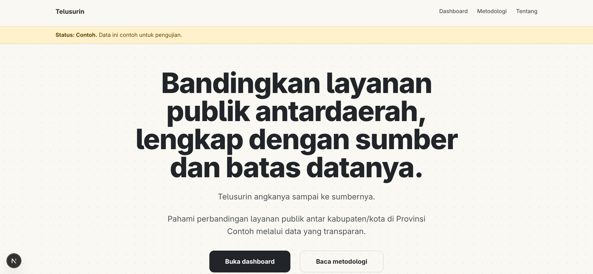
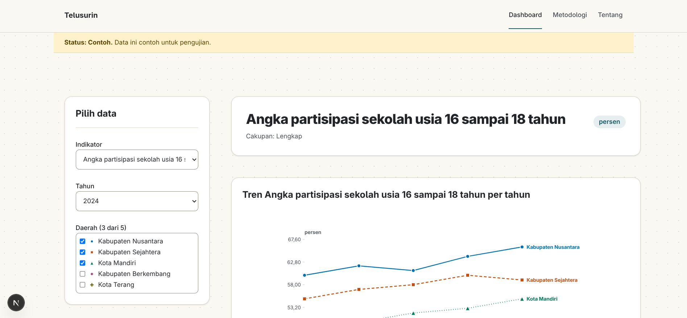
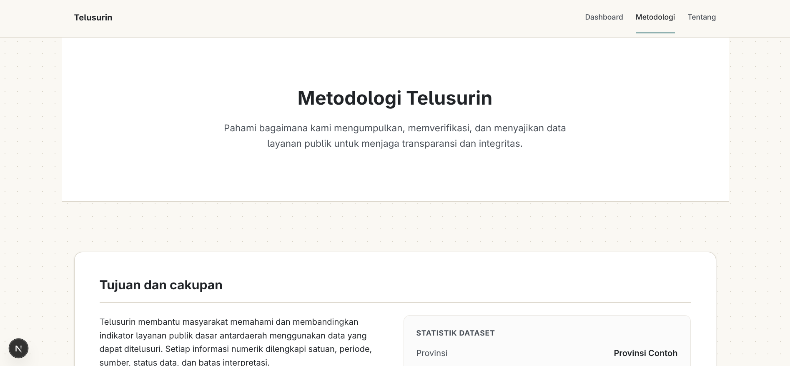

# Telusurin

Telusurin adalah platform web untuk membandingkan indikator layanan publik dasar antardaerah. Setiap angka disertai satuan, periode, sumber, status data, dan batas interpretasinya.

Dikembangkan untuk WIA MIA 2026. Tema: *Designing Digital Futures: Powering Public Transparency*. Subtema: *Data-Driven Decision Support*.

> Telusurin bukan produk BPS dan tidak didukung BPS.

<<<<<<< HEAD






## Status saat ini (Draf Pertama)

Data pada draf ini masih **simulasi** (status `contoh`). Data resmi menyusul di tahap Final.
=======
<!-- Screenshot: -->

## Status saat ini (Final)

Fitur F1 sampai F10 sudah diimplementasikan. Data pada repository ini masih **simulasi** (status `contoh`); dataset resmi BPS harus diimpor tim sebelum pengumpulan (lihat "Yang masih harus dikerjakan tim").
>>>>>>> 7904ff0 (feat: BPS production dataset integration and final-stage polish)

| Bagian | Status |
| --- | --- |
| Dokumen produk, desain, dan spesifikasi | [x] Selesai (`prd.md`, `design.md`, `spec.md`) |
| Provinsi dan indikator draf | [x] Jawa Timur (kandidat), data simulasi aktif |
| Landing page (F1) | [x] Selesai |
| Dashboard: indikator, filter daerah, tren, perbandingan, tabel, sumber dan status (F2 sampai F7) | [x] Selesai |
| Metodologi (F8) | [x] Selesai |
| Insight berbasis aturan (F9) | [x] Selesai (`src/domain/insights.ts`, I1 sampai I5, dengan bukti hitung) |
| Ekspor CSV (F10) | [x] Selesai (`src/lib/csv.ts`, tombol di dashboard) |
| Metodologi lengkap (PRD 12, butir 1 sampai 12) | [x] Selesai |
| Integrasi data BPS asli | [ ] **Belum**: butuh unduhan manual dan pemeriksaan sampel oleh tim |

## Teknologi

Next.js (App Router), React, TypeScript, Tailwind CSS, Zod, Vitest, ESLint. Data berupa berkas JSON yang divalidasi dengan Zod; tidak ada database atau API luar di versi draf.

## Menjalankan proyek

Kebutuhan: Node.js dan npm.

```bash
git clone https://github.com/wiryaptr/telusurin.git
cd telusurin
npm install
```

Salin konfigurasi env:

- PowerShell: `Copy-Item .env.example .env.local`
- Bash: `cp .env.example .env.local`

Pastikan `.env.local` berisi baris berikut (tanpa tanda `#` di depannya):

```
TELUSURIN_DATASET=fixture
```

Lalu jalankan:

```bash
npm run dev
```

Buka http://localhost:3000.

Pada draf ini dataset produksi belum tersedia, jadi aplikasi dijalankan dengan dataset simulasi di `tests/fixtures/dataset`. Tanpa variabel di atas, dashboard tidak menemukan data.

### Catatan: validasi data dan build

- `npm run validate-data` dan `npm run build` dijalankan lewat `tsx`, yang tidak membaca `.env.local`. Set variabelnya langsung di terminal:
  - PowerShell: `$env:TELUSURIN_DATASET="fixture"`
  - Bash: `export TELUSURIN_DATASET=fixture`
- `npm run build` sengaja gagal selama hanya ada data simulasi, karena validasi menolak status `contoh` pada build produksi. Untuk draf ini cukup gunakan `npm run dev`. Build produksi menunggu dataset resmi di tahap Final.

## Yang masih harus dikerjakan tim

1. Unduh data BPS, simpan di `data/raw/<source-id>/`, tulis `scripts/import/<source-id>.ts`, isi `src/data/dataset/*.json` (spec bagian 5). Tidak ada angka yang dikarang untuk mengisi dataset ini.
2. Pemeriksaan sampel 10 nilai oleh dua anggota, catat di `docs/validation-report.md`; setelah itu status menjadi `resmi` (insight hanya memakai data `resmi`).
3. `npm run build` baru lolos setelah dataset produksi tanpa status `contoh` ada.
4. Uji pengguna 3 sampai 5 orang (`docs/user-testing.md`), Lighthouse di produksi, deploy Vercel.
5. Jalankan `npm install && npm run lint && npm run typecheck && npm test && npm run validate-data`. Kode F9 dan F10 diuji di luar Vitest dan belum dijalankan lewat perintah-perintah ini.

## Format CSV

Koma sebagai pemisah, UTF-8 dengan BOM, akhir baris CRLF, titik desimal. Excel berlokal Indonesia mungkin perlu **Data > Dari Teks/CSV** dengan pemisah koma. Isi mengikuti tabel di dashboard (daerah terpilih, semua tahun tersedia). Nilai kosong tetap kosong dengan alasan di kolom `keterangan_kosong`.

## Script yang tersedia

| Script | Fungsi |
| --- | --- |
| `npm run dev` | Menjalankan server pengembangan |
| `npm run build` | Menjalankan `validate-data`, lalu `next build` |
| `npm run start` | Menyajikan hasil build |
| `npm run lint` | Memeriksa kode dengan ESLint |
| `npm run typecheck` | Memeriksa tipe TypeScript |
| `npm test` | Menjalankan tes unit dengan Vitest |
| `npm run validate-data` | Memvalidasi dataset terhadap skema dan aturan integritas |
| `npm run format` | Merapikan kode dengan Prettier |

## Struktur dokumen

| Berkas | Isi |
| --- | --- |
| `prd.md` | Dokumen kebutuhan produk |
| `design.md` | Dokumen desain |
| `spec.md` | Spesifikasi teknis |
| `docs/data-sources.md` | Sumber data, gerbang indikator, dan kamus indikator |
| `docs/decisions/README.md` | Catatan keputusan tim |
| `docs/validation-report.md` | Laporan validasi data (diisi setelah data resmi ada) |

## Atribusi Sumber Data

Data yang digunakan dalam draf pertama ini adalah dataset **fixture (simulasi)** untuk tujuan pengembangan dan demonstrasi fungsi sistem.

- **Sumber simulasi:** Buku Pendidikan Tahunan (contoh)
- **Status:** `contoh` (data simulasi, bukan angka nyata)

Sumber BPS yang direncanakan untuk tahap Final dicatat di `docs/data-sources.md`. Angka dari sumber itu belum diimpor ke dataset.

## Pengembangan dengan AI

Proyek ini dikembangkan dengan bantuan alat bantu AI (opencode) untuk mempercepat penulisan kode, skema validasi, dan unit test. Seluruh perubahan ditinjau dan di-commit oleh anggota tim.

## Catatan untuk mentor

1. Rata-rata sederhana tanpa bobot penduduk: cukup untuk MVP atau perlu bobot?
2. Provinsi dan indikator mana yang realistis selesai sampai 16 November?
3. Apakah insight berbasis aturan sudah cukup kuat sebagai nilai jual?
4. Prioritas Final: data asli dulu atau tampilan dan fitur dulu?
5. Bagian spec mana yang terlalu berat untuk waktu yang tersisa?

## Tim

| Nama | Peran |
| --- | --- |
| Arya Wirya Putra Jatmiko | [ISI] |
| Mirza Fadhil Naufal   | [ISI] |
| Muhammad Afifudin Zain | [ISI] |

## Lisensi

Lisensi kode: belum ditentukan. Data tetap tunduk pada ketentuan penggunaan sumber masing-masing.
